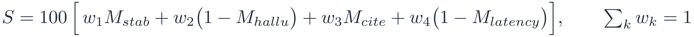

# 공공입찰 RAG 답변 생성 LLM 비교 평가

공공입찰 문서 질의응답 RAG 시스템에 넣을 **답변 생성 LLM**을 고르기 위해, 로컬 CPU 환경에서 실행 가능한 오픈 모델 10종을 같은 조건으로 비교한 평가 기록이다.

- **결론**: 도입 PC 메모리 관문(10GB)을 통과한 9종 가운데 **Qwen3-8B**가 정답 안정도·환각률·인용 정확도 세 품질 지표에서 모두 1위다. 대가는 응답 시간(9종 중 8위)이다.
- **판정자**: Claude Fable 5.1 (Anthropic). 14,750건 전부 같은 기준서·같은 절차로 판정했다. → [판정 절차](docs/method.md#판정)
- **보고서**: [report/llm-selection-report.pdf](report/llm-selection-report.pdf)

## 한눈에 보기

| 모델 | 정답 | 환각 | 정답 안정도 | 인용 정확도 | 응답 p50 | 메모리 |
|---|---|---|---|---|---|---|
| Qwen3-14B | 87.7±2.8 | 11.3±1.4 | 84.9 | 87.9 | 47.8s | **14.81GB (탈락)** |
| **Qwen3-8B** | **84.0±3.1** | **14.3±1.6** | **80.9** | **86.5** | 26.4s | 8.28GB |
| Llama-3.1-8B | 72.0±2.9 | 24.2±5.0 | 69.1 | 77.7 | 21.8s | 8.19GB |
| Qwen3-4B | 72.1±4.0 | 26.6±5.0 | 68.1 | 79.0 | 15.2s | 4.46GB |
| Gemma-3-4B | 66.8±12.9 | 24.1±2.2 | 53.9 | 85.5 | 12.3s | 4.06GB |
| Kanana-1.5-8B | 64.7±5.0 | 28.4±3.9 | 59.7 | 64.3 | 29.2s | 8.16GB |
| Kanana-1.5-2.1B | 56.5±9.1 | 34.0±5.0 | 47.4 | 83.3 | 12.3s | 2.60GB |
| Mi:dm-2.0-Mini | 54.8±17.9 | 40.2±11.1 | 36.9 | 36.1 | 6.1s | 2.88GB |
| Qwen3-1.7B | 48.9±8.6 | 46.4±8.5 | 40.3 | 79.1 | 8.1s | 2.25GB |
| Gemma-3-1B | 9.7±5.0 | 33.2±16.4 | 4.7 | 14.2 | 7.5s | 1.04GB |

정답·환각은 295문항 판정, 지시문 5종 평균 ± 표준편차(%). 인용 정확도는 295문항 자동 측정. 응답 시간은 워크스테이션 CPU 실측(모델 간 비교용), 메모리는 운영 설정 실측.

## 평가 설계 요약

| 항목 | 내용 |
|---|---|
| 후보 | Qwen3 크기 사다리(1.7B~14B) × 국산(Kanana·Mi:dm)·글로벌(Gemma·Llama), 상업 이용 가능 라이선스 10종 (Q4_K_M, llama.cpp) |
| 문항 | 나라장터 공고 표본 51건(사업 5곳) → 사람 검수 요건 시트 → GPT(OpenAI)-astra로 300문항 생성. 권한 차단 5건 제외 295문항 |
| 근거 | 검색하지 않고 문항 작성자가 원문에서 고른 인용문을 전 모델에 동일 제공 (curated-reference) |
| 지시문 | 결과를 보기 전 분량·배치·제시 방식 3축으로 작성한 5종 (`prompts/`) |
| 규모 | 10모델 × 295문항 × 5지시문 = 14,750건 생성 |
| 판정 | 295문항 × 10모델 × 5지시문 = 14,750건. 정답/환각/무응답 + 유형 |
| 선정 | 메모리 관문 → **지표별 순위로 결론** → 가중 점수(참고) → 민감도 |

<picture>
  <source media="(prefers-color-scheme: dark)" srcset="docs/assets/score-formula-dark.png">
  
</picture>

참고용 가중 점수. M은 관문 통과 9종 안에서 0~1로 정규화한 값, w = (3,3,1,1)/8 (Qwen3-8B 89.0). 가중치를 0.5~3.0에서 3,000회 바꾼 민감도에서 Qwen3-8B 1위 56.4% · Gemma-3-4B 41.6%라 결론은 지표별 순위로 냈다.

자세한 내용: [docs/method.md](docs/method.md) · 지표 정의: [docs/metrics.md](docs/metrics.md) · 계산식: [docs/equations.md](docs/equations.md) · 한계: [LIMITATIONS.md](LIMITATIONS.md)

## 결과 재현

```bash
# 0) 규칙 기반 채점 (인용 정확도 · 수치 재현 · 형식 준수 · 원문 복사) — 지시문마다
python scripts/score_auto.py data/questions/questions_300.jsonl \
  data/frozen_inputs/frozen_P1.jsonl data/responses/results_P1 data/auto_scoring/P1

# 1) 판정 기록 → 모델별 지표 (정답·환각·무응답·유형·정답 안정도·형식·원문복사·속도·메모리)
python scripts/compute_metrics.py \
  --judgments data/judgments/judgments_295.jsonl \
  --auto-dir data/auto_scoring --runtime data/runtime \
  --out /tmp/metrics.json

# 2) 선정 (관문 · 지표별 순위 · 가중 점수(참고) · 민감도)
python scripts/select_model.py --metrics results/final_metrics.json --out /tmp/selection.json
```

0)과 1)은 `results/final_metrics.json`의 수치를 그대로 재현한다.

## 저장소 구성

```
docs/        평가 방법, 지표 정의, 계산식, 판정 기준서, 변경 이력
prompts/     지시문 5종 (P1~P5)
scripts/     입력 생성 · 실행 · 자동 채점 · 속도/메모리 측정 · 지표 계산 · 선정
  judge/     블라인드 판정 도구 (라벨 섞기 · 전문 표시 · 기록)
data/
  questions/        문항 300개 · 기대답 · 근거 인용
  frozen_inputs/    고정 입력 (지시문 5종)
  frozen_manifests/ 고정 입력 해시
  responses/        모델 답변 14,750건 (+ responses_thinking/)
  judgments/        판정 14,750건(100문항분+195문항분), 재확인 기록, 추론 모드 판정
  auto_scoring/     규칙 기반 채점 (문항별 · 요약)
  runtime/          속도(워크스테이션)·메모리(운영 설정) 실측
results/     최종 지표, 선정 결과, 추론 모드 비교
report/      선정 보고서 PDF, 계산식 PDF
```

## 데이터

| 자료 | 위치 |
|---|---|
| 문항 300개 · 기대답 · 근거 인용문 | `data/questions/questions_300.jsonl` |
| 고정 입력(지시문 5종 × 300문항) | `data/frozen_inputs/` · 해시 `data/frozen_manifests/` |
| 모델 답변 14,750건 | `data/responses/results_P{1..5}/<모델>/answers.jsonl` |
| 추론 모드 답변 | `data/responses_thinking/` |
| 판정 14,750건 · 재확인 기록 | `data/judgments/` |
| 규칙 기반 채점(문항별 · 요약) | `data/auto_scoring/P{1..5}/` |
| 속도 · 메모리 실측 | `data/runtime/` |

나라장터 공고 137,745행에서 정보시스템 구축·운영 분야 공고 51건을 뽑고, 팀원 5명이 조건을 요건 시트로 옮겨 검수·수정한 뒤, 그 시트를 토대로 질문 300개를 GPT(OpenAI)-astra로 생성했다. 사내 문서(`C0x-*`)는 시트 조건에 맞춰 합성한 가상 기업 자료다. 문항 ID와 테넌트 ID는 익명화했다(`Q300-*`, `tenant-c0*`). 공고에 적힌 발주기관 담당자의 실명·전화번호·이메일은 `[담당자]` `[전화번호]` `[이메일]`로 가렸다(평가 결과에는 영향 없음). 자세한 과정은 [DATA_NOTICE.md](DATA_NOTICE.md).

## 라이선스

코드는 MIT([LICENSE](LICENSE)). 데이터 출처는 [DATA_NOTICE.md](DATA_NOTICE.md) 참조.
